<p align="center">
  <a href="https://huggingface.co/spaces/iamabhayaditya/InceptionResNetV2-UNet-MBRSC-demo">
    
  </a>
  <a href="https://huggingface.co/iamabhayaditya/InceptionResNetV2-UNet-MBRSC">
    
  </a>
  <a href="https://www.gnu.org/licenses/gpl-3.0">
    
  </a>
</p>

# 🛰️ Drishti: Dubai Satellite Imagery Semantic Segmentation & Edge Optimization

An end-to-end deep learning and edge-AI pipeline for multi-class land-cover semantic segmentation from high-resolution satellite imagery (MBRSC Dubai Earth Observation Dataset). 

This project implements a **639-layer deep InceptionResNetV2-UNet** convolutional network, modernizes legacy training routines to **TensorFlow 2.x / Keras 3**, and engineers **Dynamic Post-Training Quantization (PTQ)** to explore the accuracy vs. footprint Pareto frontier for edge, drone, and on-orbit remote sensing payloads.

---

## 🌟 Key Highlights & Engineering Contributions

- **Deep Architecture:** U-Net encoder-decoder featuring an `InceptionResNetV2` feature extraction backbone with custom zero-padding spatial alignments (**639 layers**, **36.79M parameters**).
- **Superior Convergence:** Stabilized training via exponential decay learning rate scheduling, achieving **86.33% validation accuracy**, an **81.10% Dice coefficient**, and a minimum validation loss of **0.4367** at the best saved checkpoint (**Epoch 21** of 33).
- **Edge Model Compression (11.8× Footprint Reduction):** Dynamic 8-bit integer quantization (INT8 PTQ) shrinks storage from **423.14 MB down to 35.89 MB (-91.5%)** while preserving **>85% of baseline terrain mIoU** (60.28% 5-class terrain mIoU).
- **Granular Diagnostics:** Class-wise IoU degradation profiling, spatial error heatmaps, and confusion matrices analyzing micro vs. macro topology preservation.
- **Production Deployment:** Deployed an interactive demo on **Hugging Face Spaces (Gradio)** with real-time FP32 vs. INT8 latency meters and published public weights on **Hugging Face Model Hub**.

---

## 🚀 Live Interactive Demo & Hosted Models

| Resource | Link | Description |
| :--- | :--- | :--- |
| **Interactive Web App** | [**Hugging Face Space Demo**](https://huggingface.co/spaces/iamabhayaditya/InceptionResNetV2-UNet-MBRSC-demo) | Test satellite tiles with live opacity blending and FP32 vs. INT8 latency benchmarks |
| **Model Hub Repository** | [**Hugging Face Model Hub**](https://huggingface.co/iamabhayaditya/InceptionResNetV2-UNet-MBRSC) | Production weights (`.keras`, `.h5`, `fp32.tflite`, `int8.tflite`) + Model Card |
| **Core Training Notebook** | [`final.ipynb`](./final.ipynb) | End-to-end data pipeline, model training, evaluation, and diagnostic heatmaps |
| **Quantization & Benchmarking** | [`PTQ_testing_dynamic_&_static.ipynb`](./PTQ_testing_dynamic_&_static.ipynb) | TFLite FP32 vs. INT8 conversion, CPU/GPU latency profiling, and degradation tables |
| **Deployment Automation** | [`Deployment_2_HFSpaces.ipynb`](./Deployment_2_HFSpaces.ipynb) | Automated Gradio app packaging and cloud deployment scripts |

---

## 🛠️ Tech Stack & Frameworks

<p align="center">
  
  
  
  
  
  
  
  
  
  
</p>

---

## 📊 Dataset & Semantic Ontology

The dataset is derived from the **Dubai Satellite Imagery Dataset**, collected by the **Mohammed Bin Rashid Space Centre (MBRSC)** and published via [Humans in the Loop](https://humansintheloop.org/resources/datasets/semantic-segmentation-dataset/). It features high-resolution Earth Observation aerial imagery spanning urban, coastal, and arid desert landscapes.

<p align="center">
  
</p>

### Target Land-Cover Categories

| Class | R | G | B | Color Preview | Description |
| :--- | :---: | :---: | :---: | :---: | :--- |
| **Water** | 226 | 169 | 41 |  | Coastline, Persian Gulf maritime waters, canals, and open basins |
| **Land (unpaved)** | 132 | 41 | 246 |  | Desert terrain, unpaved sand, bare soil, and undeveloped plots |
| **Road** | 110 | 193 | 228 |  | Highways, urban streets, bridges, and asphalt infrastructure |
| **Building** | 60 | 16 | 152 |  | Commercial skyscrapers, residential blocks, and built structures |
| **Vegetation** | 254 | 221 | 58 |  | Trees, parks, landscaped greenery, and agricultural plots |
| **Unlabeled** | 155 | 155 | 155 |  | Boundary margins, shadows, and unclassified artifacts |

### Sample Aerial Tiles & Ground Truth Masks

<p align="center">
  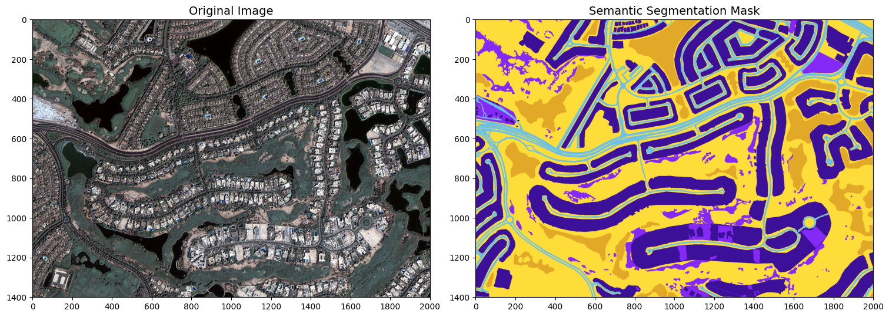<br><br>
  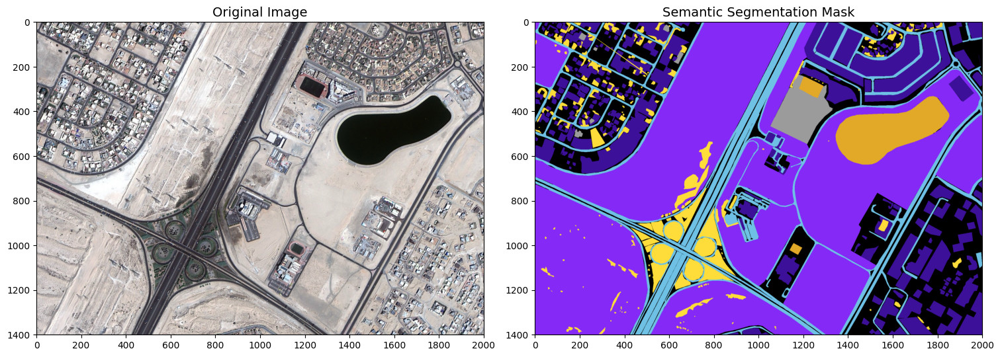<br><br>
  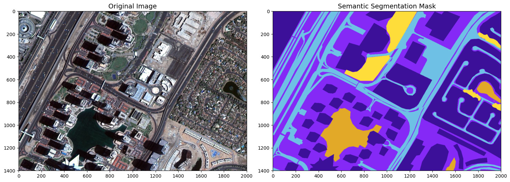
</p>

---

## ⚙️ Data Preprocessing & Augmentation Pipeline

The original dataset comprises **72 high-resolution image-mask pairs** across 8 satellite tiles (`t1` through `t8`). To prevent spatial data leakage across splits, pairs are partitioned geographically within each tile:

* **Training Set:** 56 original pairs (7 pairs/tile) $\rightarrow$ expanded via offline albumentations to **504 augmented tiles** ($512 \times 512$).
* **Validation Set:** **16 unaugmented pairs** (2 pairs/tile) preserved strictly in their raw spatial distribution ($512 \times 512$).

Augmentations include random crops, horizontal/vertical reflections, affine rotations, CLAHE contrast adjustments, brightness jitter, and optical/grid distortions:

<p align="center">
  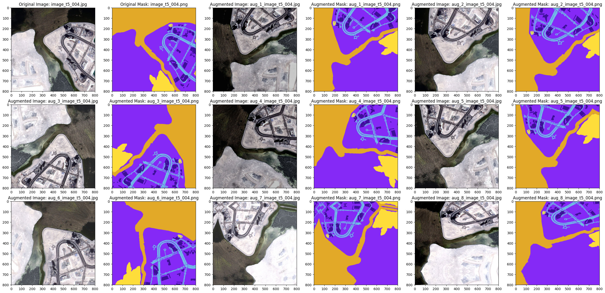<br><br>
  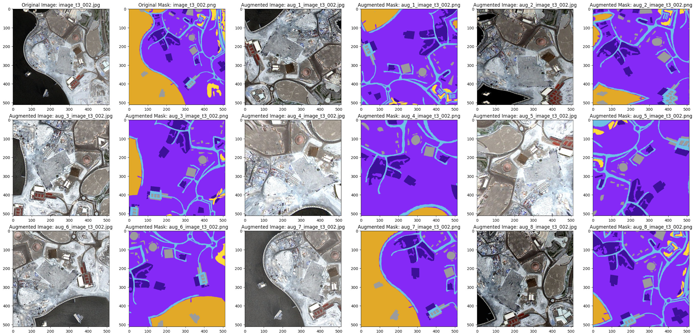
</p>

---

## 🏗️ Neural Network Architecture

The architecture is a **639-layer deep U-Net** leveraging a pre-trained **`InceptionResNetV2`** encoder to extract multi-scale spatial representations.

<p align="center">
  
</p>

### Parameter & Layer Breakdown
* **Total Parameters:** `36,793,414` (140.36 MB)
* **Trainable Parameters:** `36,752,390` (140.20 MB)
* **Non-trainable Parameters:** `41,024` (160.25 KB - Batch Normalization moving statistics)
* **Total Graph Layers:** **`639 Layers`** (197 Conv2D, 196 Activations, 166 BatchNorm, 36 Concatenate, 30 CustomScaleLayers, 4 Conv2DTranspose, 4 ZeroPadding2D alignment layers, 3 MaxPooling2D, 1 AvgPooling2D, 1 Dropout, 1 InputLayer).

### Spatial Dimension Alignment
InceptionResNetV2 outputs intermediate feature maps with non-power-of-two spatial dimensions ($255\times255$, $126\times126$, $61\times61$, $30\times30$). Four dedicated `ZeroPadding2D` alignment stages pad these tensors to clean powers of two ($256\times256$, $128\times128$, $64\times64$, $32\times32$) to enable pixel-perfect skip concatenations in the decoder.

---

## 🎯 Training Specifications & Convergence

* **Input Resolution:** `512 × 512 × 3` (RGB normalized to `[0, 1]`)
* **Batch Size:** `4` (optimized for GPU memory stability on large $512\times512$ feature volumes)
* **Steps per Epoch:** `126` ($\lceil 504 \div 4 \rceil$)
* **Validation Steps:** `16` ($\lceil 4 \times 16 \div 4 \rceil$)
* **Epochs Trained:** `33` (converged via EarlyStopping & ModelCheckpoint)
* **Optimizer:** Adam with exponential learning rate decay ($\text{LR}_0 = 10^{-4}$)
* **Loss Function:** `categorical_crossentropy`
* **Evaluation Metrics:** `dice_coef`, `categorical_accuracy`

### Epoch-Wise Training Progression

The training loop ran for **33 epochs** with EarlyStopping(monitor='val_loss', patience=12, restore_best_weights=True). The lowest validation loss was achieved at **Epoch 21**, which was automatically saved as the production checkpoint:

| Training Milestone | Train Accuracy | Train Dice Coeff | Train Loss | Val Accuracy | Val Dice Coeff | Val Loss (monitor) | Learning Rate |
| :--- | :---: | :---: | :---: | :---: | :---: | :---: | :---: |
| 🏆 **Best Checkpoint (Epoch 21)** | **0.8369** (83.69%) | **0.7801** (78.01%) | **0.2298** | **0.8633** (86.33%) | **0.8110** (81.10%) | **0.4367** (Minimum) | 4.64e-5 |
| ⏹️ **Final Epoch (Epoch 33 - Early Stop)** | **0.8464** (84.64%) | **0.8037** (80.37%) | **0.1908** | **0.8624** (86.24%) | **0.8172** (81.72%) | **0.4594** | 2.93e-5 |

> **Checkpoint Note:** While later epochs (such as Epoch 31 and 33) showed slight variations in Dice and training loss, the model weights preserved on disk and exported to TFLite originate from **Epoch 21** because ModelCheckpoint strictly guarded the lowest validation loss (**0.43671**).

*Detailed epoch-by-epoch loss and metric progressions are documented in [model_training_33.csv](./model_training_33.csv).*

---

## 📈 Quantitative Benchmark Results

### 1. Per-Class Segmentation Performance (Baseline FP32)

Evaluated on the 16 independent validation tiles across all classes ([`baseline_metrics_table.csv`](./baseline_metrics_table.csv)):

| Class | IoU | Dice / F1-Score | Precision | Recall |
| :--- | :---: | :---: | :---: | :---: |
| 🌊 **Water** | **0.9015** | **0.9482** | **0.9429** | **0.9536** |
| 🏜️ **Land (unpaved)** | **0.8083** | **0.8940** | **0.8733** | **0.9157** |
| 🏢 **Building** | **0.6806** | **0.8099** | **0.7799** | **0.8423** |
| 🌿 **Vegetation** | **0.6163** | **0.7626** | **0.8441** | **0.6954** |
| 🛣️ **Road** | **0.5105** | **0.6759** | **0.6999** | **0.6535** |
| ❓ **Unlabeled** | **0.0282** | **0.0548** | **0.3341** | **0.0298** |
| **Mean (mIoU / Overall)** | **0.5909** | **0.6909** | **0.7457** | **0.6817** |
| **5-Class Terrain mIoU** | **0.7034** | **0.8181** | **0.8280** | **0.8121** |

---

### 2. Edge Quantization & Model Compression Trade-Offs

We evaluated Post-Training Quantization (PTQ) to establish the accuracy-vs-efficiency trade-off for on-device inference ([`baseline_edge_benchmarks.csv`](./baseline_edge_benchmarks.csv)):

| Model Checkpoint | Precision | Disk Size | Compression Ratio | Overall mIoU | 5-Class Terrain mIoU | CPU Latency | GPU Latency | Throughput |
| :--- | :---: | :---: | :---: | :---: | :---: | :---: | :---: | :---: |
| **Keras (`.keras`)** | FP32 | 423.14 MB | Baseline (1.0×) | **59.09%** | **70.34%** | 4,693.27 ms | **638.39 ms** | 1.57 FPS (GPU) |
| **TFLite (`.tflite`)** | FP32 | 140.36 MB | ~3.0× smaller | **59.09%** | **70.34%** | ~4,200 ms | — | 0.24 FPS (CPU) |
| **TFLite INT8 (`.tflite`)** | Dynamic INT8 | **35.89 MB** | 🚀 **11.8× smaller (-91.5%)** | **51.08%** | **60.28%** | 15,911.85 ms | — | 0.06 FPS (CPU) |

> **Key Takeaway:** Dynamic INT8 quantization slashes model memory footprint by **91.5%** (saving **387.25 MB**), while retaining **60.28%** terrain mIoU (**>85% relative retention**), enabling deployment within memory-constrained drone and satellite edge computers.

---

### 3. Class-Wise Quantization Degradation Analysis

| Class | Baseline IoU (FP32) | INT8 IoU (Quantized) | Change ($\Delta$ IoU) | Status | Observation |
| :--- | :---: | :---: | :---: | :--- | :--- |
| 🌊 **Water** | 0.9015 | 0.8849 | -0.0166 (-1.7%) | 🟢 Preserved | Large continuous bodies retain high semantic stability |
| 🌿 **Vegetation** | 0.6163 | 0.6190 | +0.0027 (+0.3%) | 🟢 Preserved | Color-distinct green canopy is unaffected by 8-bit scaling |
| 🏜️ **Land** | 0.8083 | 0.7761 | -0.0322 (-3.2%) | 🟢 Very Stable | Dominant desert land mass maintains consistent boundaries |
| 🛣️ **Road** | 0.5105 | 0.3327 | -0.1778 (-17.8%) | 🟡 Moderate Drop | Narrow asphalt corridors experience boundary erosion |
| 🏢 **Building** | 0.6806 | 0.4012 | -0.2794 (-27.9%) | 🔴 Major Drop | Complex roof geometric corners suffer under dynamic range clipping |

---

## 🖼️ Qualitative Segmentation Visualizations

Below are sample 3-panel segmentations generated on the held-out validation set (`Input Satellite Patch` | `Ground Truth Annotation` | `Model Prediction`):

<p align="center">
  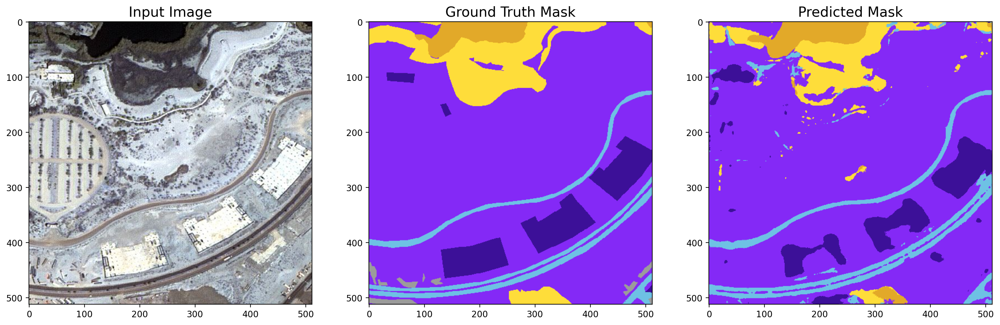<br><br>
  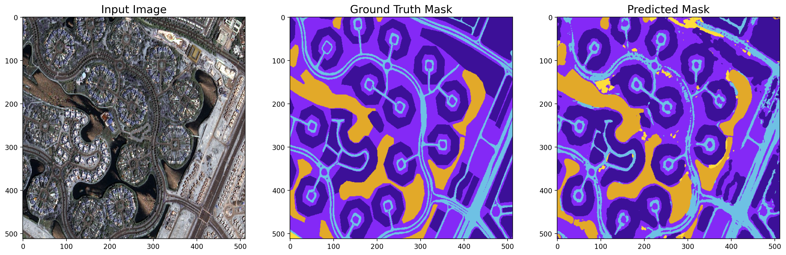<br><br>
  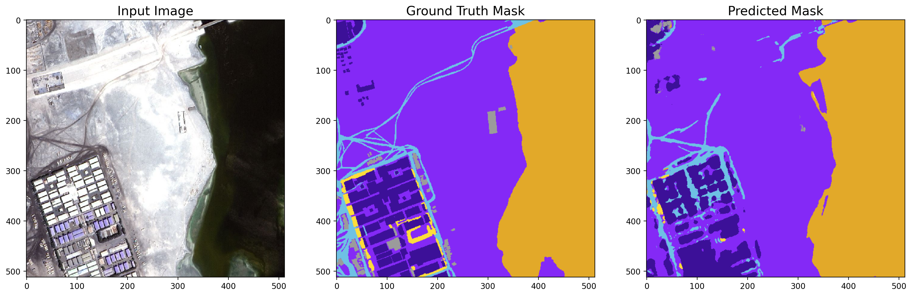<br><br>
  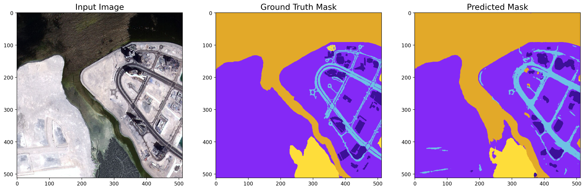
</p>

*All 16 full-resolution validation evaluations are available in the [`predictions/predictions/`](./predictions/predictions/) directory.*

---

## 🔬 Feature Activation Visualizations

Intermediate feature activations demonstrate hierarchical feature extraction from early low-level edges to high-level semantic maps:

| Layer: `conv2d` (Stem) | Layer: `conv2d_8` (Inception-A) | Layer: `conv2d_34` (Inception-B) | Layer: `conv2d_70` (Inception-C) |
| :---: | :---: | :---: | :---: |
| 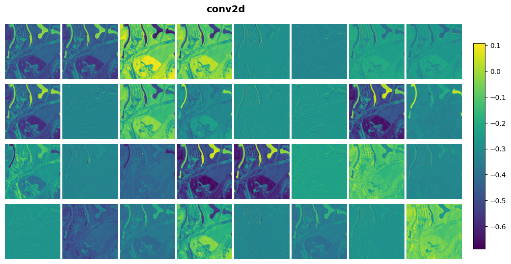 | 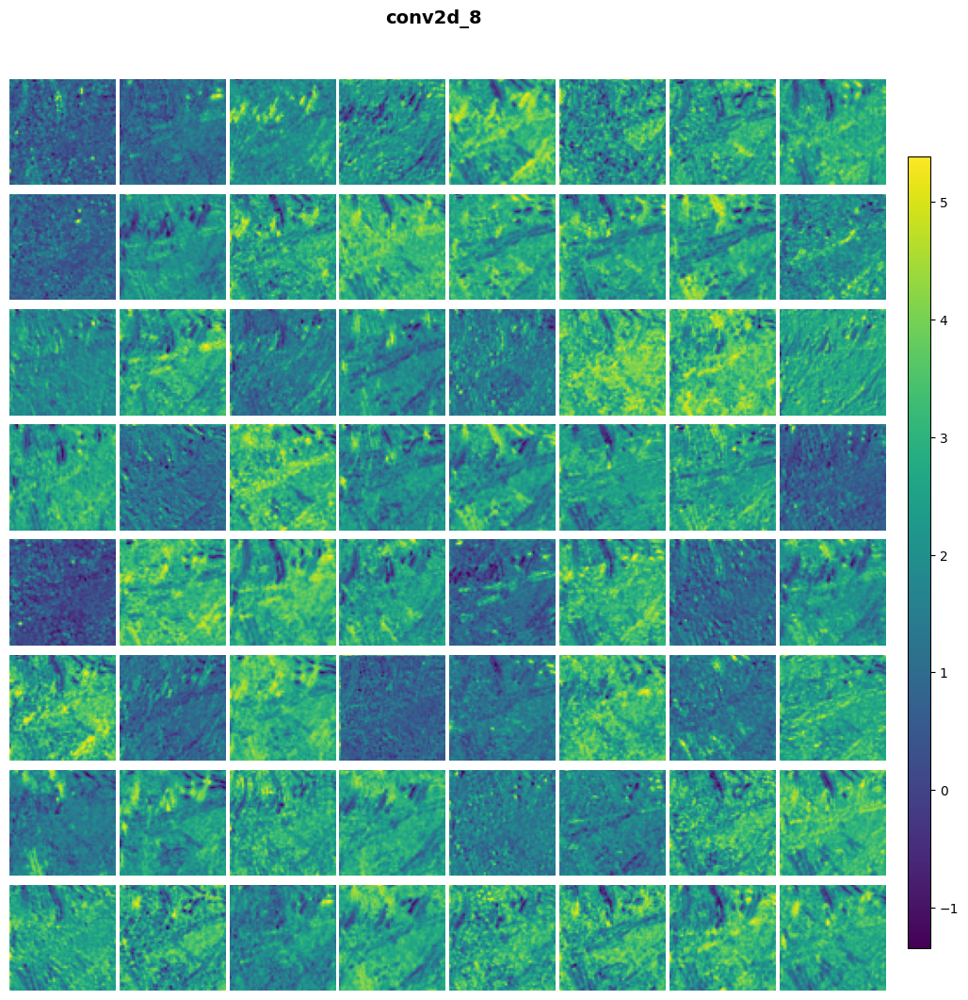 | 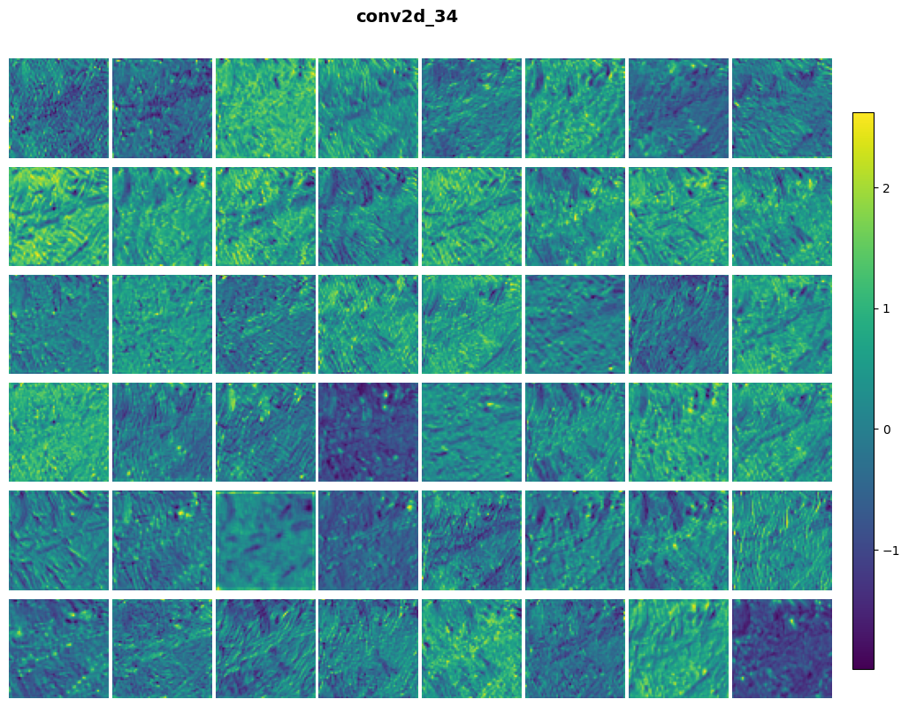 | 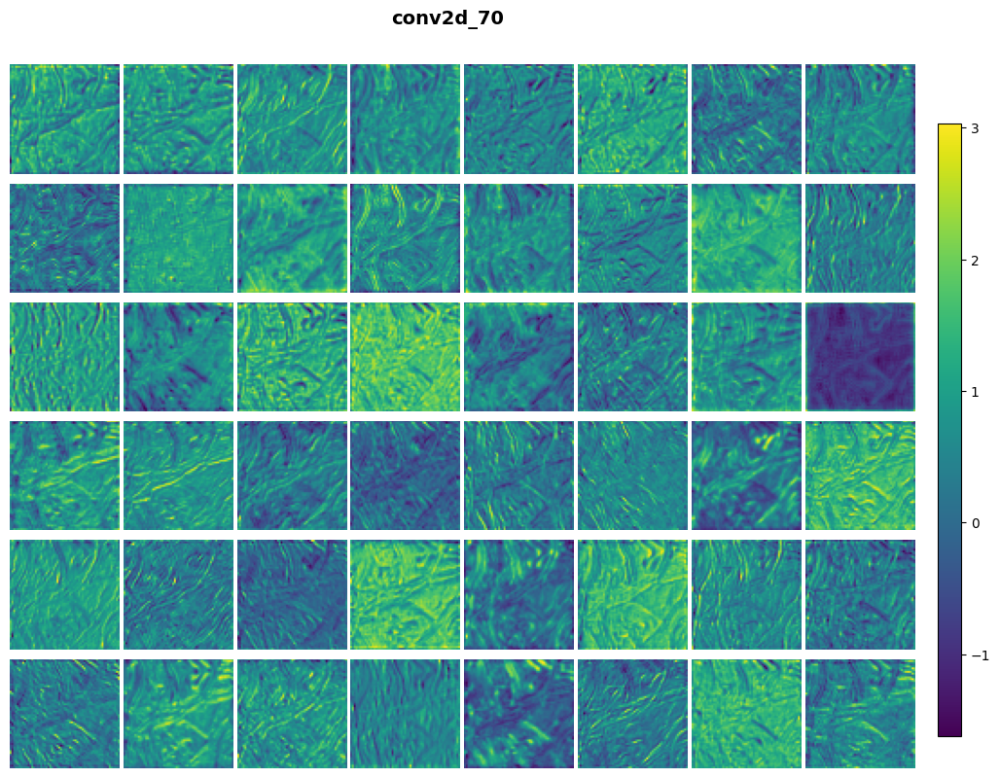 |

*Full layer-by-layer activation dumps are available in the [`activations_abhay/`](./activations_abhay/) directory.*

---

## 💻 Quickstart: How to Use the Models

### 1. Load Full-Precision Keras Model
```python
import tensorflow as tf
from huggingface_hub import hf_hub_download

# Download weights from Hugging Face Hub
model_path = hf_hub_download(
    repo_id="iamabhayaditya/InceptionResNetV2-UNet-MBRSC",
    filename="InceptionResNetV2-UNet.keras"
)

model = tf.keras.models.load_model(model_path, compile=False)
```

### 2. Run Edge Inference with TFLite (INT8 Dynamic)
```python
import numpy as np
import tensorflow as tf
from huggingface_hub import hf_hub_download

# Download quantized model (35.89 MB)
tflite_path = hf_hub_download(
    repo_id="iamabhayaditya/InceptionResNetV2-UNet-MBRSC",
    filename="InceptionResNetV2-UNet_int8.tflite"
)

interpreter = tf.lite.Interpreter(model_path=tflite_path)
interpreter.allocate_tensors()

input_details = interpreter.get_input_details()
output_details = interpreter.get_output_details()

# Input normalized float32 image: (1, 512, 512, 3)
interpreter.set_tensor(input_details[0]['index'], input_tensor)
interpreter.invoke()

# Output probability volume: (1, 512, 512, 6)
predictions = interpreter.get_tensor(output_details[0]['index'])
pred_mask = np.argmax(predictions[0], axis=-1)
```

---

## 📜 Lineage & Attribution

This project builds upon the foundational open-source baseline by [Ayush Dabra](https://github.com/ayushdabra/dubai-satellite-imagery-segmentation) licensed under the **GNU General Public License v3.0 (GPL-3.0)**.

### Substantial Modernization & Engineering Additions:
1. **Framework & API Modernization:** Upgraded deprecated TensorFlow 1.x / early 2.x routines to **modern TensorFlow 2.x and Keras 3**, replacing obsolete generators and fixing dimension mismatches.
2. **Training Stabilization:** Implemented dynamic exponential learning rate decay with automated checkpointing and early stopping, lifting validation accuracy to **86.33%** and Dice to **81.10%** at the best saved checkpoint (Epoch 21, val_loss: 0.4367).
3. **Edge Optimization & Quantization (PTQ):** Engineered post-training dynamic INT8 quantization via TensorFlow Lite / LiteRT, reducing disk size by **91.5% (423 MB $\rightarrow$ 35.89 MB)**.
4. **Hardware Latency Benchmarking:** Built end-to-end benchmarking suites measuring multi-threaded CPU vs. GPU latency, throughput (FPS), and per-class quantization degradation.
5. **Interactive Deployment & Hub Release:** Shipped an interactive Gradio application on **Hugging Face Spaces** and structured **Hugging Face Model Hub** artifacts.

---

## 📄 License

This repository is licensed under the [GNU General Public License v3.0 (GPL-3.0)](./LICENSE).
